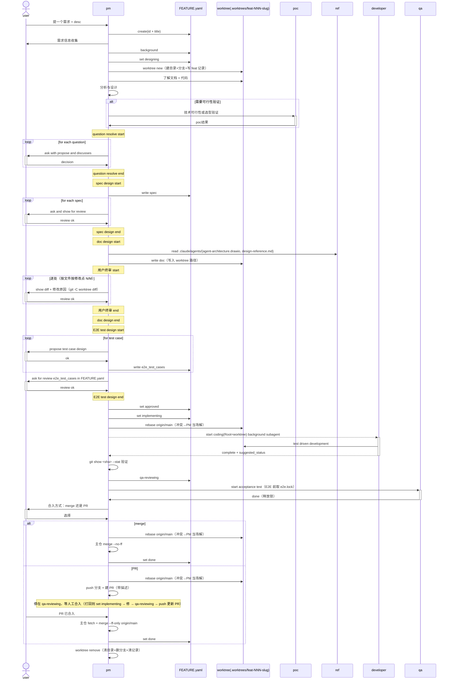

# feature
## schema
- id # feature编号
- title # feature标题，与目录一致
- desc # 需求描述
- background # 需求背景，为什么要做这个需求
    - pain_point # 解决什么痛点
    - benefit # 带来什么收益
- spec # 需求规格
    - module # 改动所在模块名，或 backend / frontend / skill / mcp
        - functions # 功能、修改点
            1. function_1 
            2. function_2
- e2e_test_cases # E2E 验收用例（可构造、可观测、可运行）
  1. test_case_1 # 端到端测试用例
    - name
    - precondition # 前置条件
    - inputs # 测试输入
    - steps # 测试步骤
    - observations
      - check  # 测试验证点
      - expect  # 预期结果

## state
  draft → designing → approved → implementing → qa-reviewing → done
  任意状态 → cancelled

## workflow
