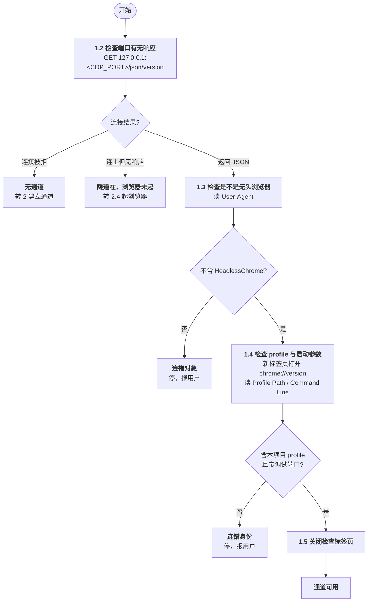
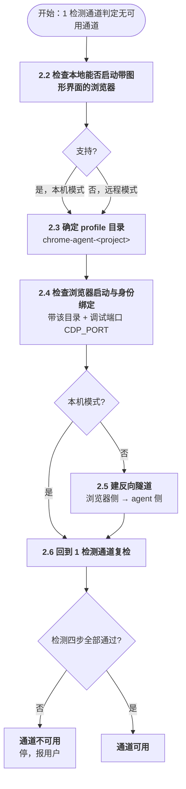
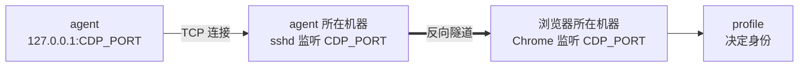

# Browser Reference

> 浏览器通道的操作手册。所有 agent（PM / QA / developer / qa-diagnosis / patrol）操作浏览器前先读本文。
> 只写协议与判据，不写项目命令 / 端口 / 地址 / 选择器——那些在 `agent-factory.yaml` 的 `verification:` 段与项目验证资产里。

**状态**：重写中。按实际操作的先后顺序逐节定稿。

[TOC]

## 0 常量

全文只在这一处定义，其余各处直接引用，不重复赋值。

| 常量 | 值 | 含义 | 用在 |
|---|---|---|---|
| `CDP_PORT` | `9222` | 调试端口。本机模式由 agent 传给浏览器，远程模式由用户传给浏览器，隧道两端也用同一个值 | 1.2 检查端口、2.4 起浏览器、2.5 建反向隧道 |

profile 目录不是常量，是规则算出来的，见 2.3 确定 profile 目录。

## 1 检测通道

动手前先回答一个问题：**现在有没有一条可用的通道**。

### 1.1 全局流程



| 节 | 检查什么 | 通过 → | 不通过 → |
|---|---|---|---|
| 1.2 | 端口上有没有东西活着 | 1.3 | 连接被拒→2 建立通道<br>连上无响应→2.4 起浏览器 |
| 1.3 | 是不是无头浏览器 | 1.4 | 停，报用户 |
| 1.4 | 加载的是不是本项目 profile | 1.5 | 停，报用户 |
| 1.5 | —— | 通道可用 | —— |

全局约束：

| # | 约束 |
|---|---|
| 1 | 任何一步判错都停并报用户：不换端口、不重启浏览器、不忽略继续 |
| 2 | 1.2、1.3 被动（一次 HTTP GET），1.4 主动（开标签页）；先被动排除错误对象，不在别人的浏览器上留痕迹 |

### 1.2 检查端口有无响应

| 项 | 内容 |
|---|---|
| 动作 | `GET http://127.0.0.1:<CDP_PORT>/json/version` |
| 判据 | 返回 JSON |
| 判据分支 | 返回 JSON → 通过，进 1.3<br>连接被拒（无人监听）→ 无通道，转 2 建立通道<br>连上但对方立即关闭（无响应）→ 隧道在但转发目标未起，转 2.4 起浏览器 |
| 三种结果的成因 | 连接被拒 = 没有隧道；连上无响应 = 隧道在但浏览器没开端口；返回 JSON = 两端都活 |
| 端口 | 用 `CDP_PORT`（见 0 常量），本机与远程两种模式相同，不做扫描 |
| 边界 | 本步只判连接结果；是不是无头留给 1.3，是什么身份留给 1.4 |

### 1.3 检查是不是无头浏览器

| 项 | 内容 |
|---|---|
| 动作 | 读 1.2 响应里的 `User-Agent` |
| 判据 | 不含 `HeadlessChrome` |
| 判据分支 | 含 `HeadlessChrome` → 无头浏览器 → 连错对象，停，报用户<br>不含，是 `Chrome` → 有界面浏览器 → 通过，进 1.4 |

### 1.4 检查 profile 与启动参数

| 项 | 内容 |
|---|---|
| 动作 | 新标签页打开 `chrome://version`，读 `Profile Path` / `Command Line` |
| 判据 | `Profile Path` 含按 2.3 规则算出的目录名，**且** `Command Line` 带 `--remote-debugging-port=<CDP_PORT>` |
| 判据分支 | 两项都满足 → 通过，进 1.5<br>任一不满足 → 连错身份，停，报用户 |
| 两个字段都看 | 只看 `Profile Path` 能证明身份对，但证明不了调试端口来自这个 profile——Chrome ≥136 在默认目录下静默忽略端口，身份看着对、端口其实来自别处 |
| 路径比对 | 按路径段，不按后缀：`\` 全换成 `/` → 按 `/` 切段 → 判断含 2.3 算出的目录名 → Windows 忽略大小写 |
| 实测样例 | `--user-data-dir` 指父目录，`Profile Path` 报的是其下的 `Default` 子目录 |
| 取命令行 | 走 `chrome://version` 页面；不用 `Browser.getBrowserCommandLine`——该 CDP 方法需 `--enable-automation`，普通启动拿不到，会报错 |

```
--user-data-dir=/home/wentao/.claude-tmp/probe-profile
Profile Path     /home/wentao/.claude-tmp/probe-profile/Default
```

### 1.5 关闭检查标签页

| 项 | 内容 |
|---|---|
| 动作 | 关闭 1.4 打开的标签页 |
| 判据 | 该标签页已关闭 |
| 判据分支 | 已关闭 → 通道可用<br>未关闭 → 报用户；不影响通道可用性，但须说明残留 |
| 边界 | 不关用户原有标签、不导航用户当前页 |

## 2 建立通道

1 检测通道判定无通道或连错时，本章把通道建出来。

### 2.1 全局流程



| 节 | 做什么 | 通过 → | 不通过 → |
|---|---|---|---|
| 2.2 | 本地能否启动带图形界面的浏览器：支持→本机，不支持→远程 | 2.3 | —— |
| 2.3 | 算出 profile 目录名（本机/远程相同，校验统一在 1.4） | 2.4 | —— |
| 2.4 | 带该目录与调试端口启动，确认身份已绑定 | 2.5（远程）/ 2.6（本机） | 停，报用户 |
| 2.5 | 仅远程；浏览器侧建反向隧道 | 2.6 | 停，报用户 |
| 2.6 | 回到 1 检测通道重走一遍 | 通道可用 | 停，报用户 |

全局约束：

| # | 约束 |
|---|---|
| 1 | 任何一步不通过都停并报用户：不换端口、不杀占用者、不重复建、不跳过 |
| 2 | 2.2、2.3 是判定，2.4、2.5 才动环境；先判定，再动手 |

### 2.2 检查本地能否启动带图形界面的浏览器

| 项 | 内容 |
|---|---|
| 判据 | 本地能否启动带图形界面的浏览器 |
| 判据分支 | 支持 → 本机模式<br>不支持 → 远程模式 |
| 产出 | 本机模式或远程模式，进 2.3 |

### 2.3 确定 profile 目录

| 项 | 内容 |
|---|---|
| 规则 | `chrome-agent-<project>`，`<project>` = 项目工作区目录名；配置 `profile` 有值时直接用它 |
| 根目录 | Windows `%LOCALAPPDATA%`<br>macOS `~/Library/Application Support`<br>Linux `~/.config` |
| 禁止 | 不得用 Chrome 默认目录——≥136 在默认目录下静默忽略调试端口，端口不监听也不报错 |
| 产出 | 目录名，进 2.4 |

### 2.4 检查浏览器启动与身份绑定

| 项 | 内容 |
|---|---|
| 必带参数 | `--user-data-dir=<2.3 算出的目录>` 固定身份<br>`--remote-debugging-port=<CDP_PORT>` 开调试端口 |
| 谁起 | 本机：agent<br>远程：用户 |
| 本机判据 | 进程存在且 `CDP_PORT` 有响应（须设超时）；满足 → 进 2.6，不满足 → 停，报用户 |
| 远程判据 | agent 侧无判据——浏览器与隧道都在用户机器，agent 看不到。本步只交付指令，能否用由 2.6 判定 |
| 远程不采信口头确认 | 用户说"已启动"不等于端口已开，实测出现过命令执行了但端口未监听的情况；一律以 2.6 的探测结果为准 |
| 端口被占 | 停，报用户，不杀占用者 |
| 本机补充 | 起前确认 `CDP_PORT` 空闲；目录不存在则创建<br>首次用该 profile 是空身份，需要登录就按页面提示登录一次<br>任务结束由 agent 关闭进程、删除临时 profile（长期身份除外） |
| 远程补充 | `--` 开头的参数须用 `&` 调用符，否则 PowerShell 把 `--` 当运算符报错<br>通道不通只给动作与判据，由用户执行，不代为关闭、不代为重启 |

本机：

```bash
<chrome> --user-data-dir=<2.3 目录> --remote-debugging-port=<CDP_PORT>
```

远程：

```powershell
& "C:\Program Files\Google\Chrome\Application\chrome.exe" `
  --remote-debugging-port=<CDP_PORT> `
  --user-data-dir="$env:LOCALAPPDATA\chrome-agent-<project>"
```

### 2.5 建反向隧道

| 项 | 内容 |
|---|---|
| 适用 | 仅远程模式。调试端口只绑浏览器所在机器的回环地址，agent 的 `127.0.0.1` 到不了对端 |
| 谁建 | 浏览器侧（人） |
| 动作 | 连 agent 所在机器时建立反向隧道 |
| 判据 | `CDP_PORT` 上出现监听 |
| 判据分支 | 有监听 → 通过，进 2.6<br>无监听 → 停，报用户；不换端口、不杀占用者 |
| 为什么不用"隧道进程存在" | `ssh -R` 的客户端跑在浏览器侧，agent 侧看不到该进程；agent 能看到的只有监听是否出现 |
| 约束 | 两端都用 `CDP_PORT`（见 0 常量），端口号相同便于对照<br>浏览器侧调试端口不进局域网，agent 侧也只绑回环 |



```bash
ssh -N -o ExitOnForwardFailure=yes -R <CDP_PORT>:127.0.0.1:<CDP_PORT> <agent-user>@<agent-host>
```

### 2.6 回到检测通道复检

| 项 | 内容 |
|---|---|
| 动作 | 回到 1 检测通道，重走 1.2 检查端口有无响应 → 1.3 检查是不是无头浏览器 → 1.4 检查 profile 与启动参数 → 1.5 关闭检查标签页 |
| 判据 | 1 检测通道四步全部通过 |
| 判据分支 | 全部通过 → 通道可用<br>任一不通过 → 停，报用户；不重复建、不跳过 |
