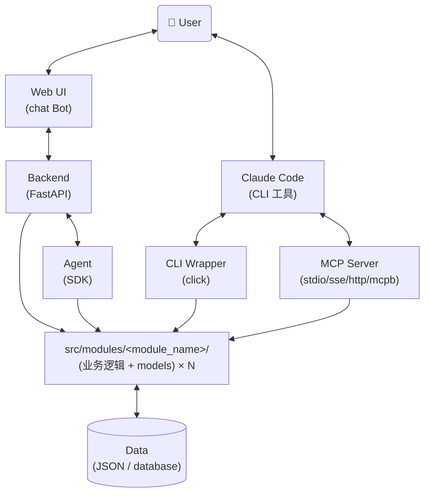

# Design Reference

> PM 设计阶段按需读取的参考手册。包含架构分层、代码目录结构、doc/ 产出清单与章节契约、schema 设计原则等规则。
> 进入 `designing` 状态时，PM 应读本文件后再撰写 doc/。

## 目录

- [Design Reference](#design-reference)
  - [目录](#目录)
  - [1. 设计工作原则](#1-设计工作原则)
  - [2. Agent参考架构](#2-agent参考架构)
    - [2.1 Module Layer](#21-module-layer)
    - [2.2 CLI Layer](#22-cli-layer)
      - [2.2.1 CLI 设计原则](#221-cli-设计原则)
      - [2.2.2 CLI 设计归属（分两阶段）](#222-cli-设计归属分两阶段)
    - [2.3 Agent Layer](#23-agent-layer)
    - [2.4 Backend Layer](#24-backend-layer)
  - [3. 代码目录结构](#3-代码目录结构)
    - [3.1 目录结构](#31-目录结构)
    - [3.2 CLI 调用方式](#32-cli-调用方式)
  - [4. 设计文档产出清单](#4-设计文档产出清单)
  - [5. doc/modules/\<module\_name\>/ 章节契约](#5-docmodulesmodule_name-章节契约)
    - [5.1 README.md（模块门面）](#51-readmemd模块门面)
      - [5.1.1 应有章节](#511-应有章节)
    - [5.2 schema.md（业务数据结构定义）](#52-schemamd业务数据结构定义)
      - [5.2.1 术语](#521-术语)
      - [5.2.2 文件结构](#522-文件结构)
        - [5.2.2.1 应有章节](#5221-应有章节)
        - [5.2.2.2 模板](#5222-模板)
      - [5.2.3 设计原则](#523-设计原则)
        - [5.2.3.1 命名原则](#5231-命名原则)
        - [5.2.3.2 类型选型原则](#5232-类型选型原则)
        - [5.2.3.3 注释原则](#5233-注释原则)
        - [5.2.3.4 一致性原则](#5234-一致性原则)
    - [5.3 persistence.md（数据存储方案，仅含持久化对象的模块才有）](#53-persistencemd数据存储方案仅含持久化对象的模块才有)
      - [5.3.1 应有章节](#531-应有章节)
      - [5.3.2 存储介质选型](#532-存储介质选型)
    - [5.4 api.md（对外接口契约 + 流程 + 配置）](#54-apimd对外接口契约--流程--配置)
      - [5.4.1 应有章节](#541-应有章节)
      - [5.4.2 模板](#542-模板)
    - [5.5 cli.md（CLI 契约，仅暴露 CLI 的模块才有）](#55-climdcli-契约仅暴露-cli-的模块才有)

## 1. 设计工作原则

- **图表优先**：流程、交互、依赖关系优先用 mermaid 表达（flowchart / sequence / state）。能用图说明的不写文字；文字仅作图的补充说明
- **聚焦核心**：文档核心是五类内容 —— 数据结构定义、数据存储方案、CLI 定义、模块边界与依赖、接口交互。其余（背景、概述、理由）保持精简
- **可审计性**：每个设计决策都必须记录选择理由，使设计过程可追溯
- **可讨论性**：设计方案应先与用户讨论确认后再定稿，不擅自做重大架构决定

## 2. Agent参考架构



### 2.1 Module Layer

**模块是 agent 系统的功能单元，提供一个独立的功能或服务。** 一个模块由以下要件构成：

| # | 要件 | 路径 | 条件 |
|---|------|------|------|
| 1 | 独立源码 | `src/modules/<module_name>/` | 所有模块 |
| 2 | 独立文档 | `doc/modules/<module_name>/` | 所有模块 |
| 3 | 独立单元测试 | `test/unit/<module_name>/` | 所有模块 |
| 4 | 独立 CLI | `src/modules/<module_name>/cli.py`（单文件） | 仅暴露 CLI 的模块 |

**命名**：`<module_name>` 统一使用下划线（`module_name`），四处路径同名。

**判别**：`modules/` 之内的是模块（`src/modules/<module_name>/`、`doc/modules/<module_name>/`）；其余目录不是模块（`src/` 下 `backend` / `frontend` / `skill` / `mcp`，`doc/` 下与 src 同名的非模块目录）。

### 2.2 CLI Layer

#### 2.2.1 CLI 设计原则
- **`--help as doc`**：CLI 命令文档通过 `python3 {Root}/src/modules/<module_name>/cli.py --help` 运行时输出获得（运行期产出），包含：
    - **功能说明**：脚本用途、内部实现原理
    - **输入说明**：参数、选项、结构化输入格式
    - **输出说明**：成功/失败响应结构、错误码定义
    - **使用示例**：典型调用场景
- **设计期契约在 `doc/modules/<module_name>/cli.md`**：暴露 CLI 的模块，设计期写 `cli.md`，含每个命令的 JSON I/O schema、错误码、使用示例，作为 developer 实现 `cli.py` 的契约。developer 实现完成后，`cli.md` 与 `--help` 输出应一致（QA 验收时机械比对）
- data-oriented：CLI 以数据为中心，提供 `data layer` 数据相关的操作，如查询、修改、新增、删除等，command 与入参设计保持精简，避免过度设计
- 结构化输入输出：除了常规 CLI 的 arguments/options，提供 json 格式输入全量入参，输出格式统一使用 json，方便代码或 agent 解析
- 使用 `click` 框架
- 使用 `dataclass` 定义 data schema
- 默认使用 `python3`

#### 2.2.2 CLI 设计归属（分两阶段）

暴露 CLI 的模块，CLI 设计分布在两处：

| 阶段 | 文件 | 内容 |
|------|------|------|
| `designing`（设计） | `doc/modules/<module_name>/cli.md` | 命令清单（产品级，要做哪些命令）+ 每命令的详细 JSON I/O schema、错误码、使用示例（设计期契约） |
| `implementing`（developer 实现） | `src/modules/<module_name>/cli.py` docstring + click decorators → 运行时 `--help` | 实现 `cli.py`，运行 `--help` 输出应与 `cli.md` 一致 |

产品级命令清单在讨论中与用户确定后直接写入 `cli.md`；developer 实现 `cli.py` 时按 `cli.md` 写 click decorators + docstring，`--help` 输出应与 `cli.md` 一致。

### 2.3 Agent Layer

- 使用 Claude SDK (Anthropic SDK) 或 Claude Agent SDK 构建 Agent
- **Agent 职责边界**：Agent 负责理解用户意图、编排任务流程、调用工具（执行实际业务逻辑的工具）
- **Agent 调用模块能力的两条路径**：
  - 经 CLI：执行 `python3 src/modules/<module_name>/cli.py <command>`（跨进程；模块未暴露 CLI 时不可用；契约见该模块的 `doc/modules/<module_name>/cli.md`）
  - 直接 import：`from src.modules.<module_name> import ...`（同进程；`__init__.py` 的公开符号即模块对外接口，契约见该模块的 `doc/modules/<module_name>/api.md`）
- Agent 通过模块的公开接口完成数据操作
- 定义目标 Agent 的 system prompt，可通过 Claude Code 的 append-system-prompt 使用，也可通过 Anthropic SDK 或 Claude Agent SDK 使用，根据实际需求决定
- 实现时可参考 `/claude-api` skill

### 2.4 Backend Layer

- backend 技术选型
- REST API 设计，针对每一个 API，列出接口定义，包括接口功能、输入、输出，使用 mermaid 语法列出 API 的调用流程，与内部模块（如 agent、`src/modules/<module_name>/`、data layer）的交互流程
- **Backend 直接 import `src/modules/<module_name>/` 的公开接口，不经过 CLI**

## 3. 代码目录结构

### 3.1 目录结构

```
{Root}/
  src/
    modules/
      <module_name>/
        __init__.py         # 对外接口：re-export 公开符号（__all__）—— api.md 的落点
        models.py           # 数据结构：dataclass + enum —— schema.md 的落点
        *.py                # 业务逻辑：按模块自身形态命名与拆分
        cli.py              # 仅暴露 CLI 的模块才有：python3 src/modules/<module_name>/cli.py --help
    backend/                # 非模块
    frontend/               # 非模块
    skill/                  # 非模块
    mcp/                    # 非模块
  doc/
    modules/
      <module_name>/
        README.md
        schema.md
        persistence.md      # 仅含持久化对象的模块才有
        api.md
        cli.md              # 仅暴露 CLI 的模块才有
  test/
    unit/
      <module_name>/
```

### 3.2 CLI 调用方式

所有 CLI 调用使用脚本方式：`python3 src/modules/<module_name>/cli.py --help`。

`cli.py` 内部通过绝对路径 import `src` 业务逻辑：

```python
# src/modules/<module_name>/cli.py
from pathlib import Path
import sys

# parents[3] = {Root}。深度由「模块定义」固定的 CLI 路径决定；CLI 路径变更需同步改此处
sys.path.insert(0, str(Path(__file__).resolve().parents[3]))
from src.modules.<module_name> import <公开接口>
# ... click 命令定义
```

## 4. 设计文档产出清单

设计完成后，产出以下文件到 `{Root}/doc/modules/<module_name>/`：

| 产出 | 条件 |
|------|------|
| `README.md` | 所有模块 |
| `schema.md` | 所有模块 |
| `persistence.md` | 仅含持久化对象的模块 |
| `api.md` | 所有模块 |
| `cli.md` | 仅暴露 CLI 的模块 |
| `python3 src/modules/<module_name>/cli.py --help` 运行时输出 | 仅暴露 CLI 的模块 |

## 5. doc/modules/<module_name>/ 章节契约

`{Root}/doc/` 下的所有文件是**最终正式文档**，仅承载"是什么"（定义、契约、方案），**不承载"为什么"**（决策、讨论、分析过程）。

每个 doc/modules/<module_name>/ 文件按以下章节组织。撰写前对照契约，撰写后自检章节是否合规。

**不写进 doc/**（写完自检，命中即删）：

| 内容 | 关键词 | 去处 |
|------|--------|------|
| 设计决策 / 决策对比 / 权衡 | `决策` `为什么` `权衡` `相比` `vs` | commit message / PR 描述 |
| 实测数据 / POC 命中率 | `实测` | commit message / PR 描述 |
| Issue / feature 编号引用 | `feature #` `issue #` `(#NNN)` | 删（commit 已关联） |
| 范围决策 | `YAGNI` `留给后续` `待定` `本期明确排除` | 删（不落库） |
| 变更记录 | `变更记录` `第一版` `第二版` `架构调整` | 删（git history 已记录） |

### 5.1 README.md（模块门面）

#### 5.1.1 应有章节

- 模块标题 + 一句话模块功能与职责

- `## 1. 名词概念` —— 本模块核心功能与职责涉及的概念名词，三列表格：
  - 列：中文名 | 英文名 | 定义
  - 定义：面向不了解本模块的人，说清「是什么 + 用来干什么」；不复述中文名
  - 定义不写实现细节
  - 定义用书面专业语，不写口语表述
  - 英文名用英文术语（Title Case 短语），不写代码标识符；业界通用的英文缩写真写英文（如 `API` / `HTTP` / `ID`），其余用中文

- `## 2. 功能与职责` —— 本模块提供什么功能：
  - 逐条列出，一条一行；每条写清该功能做什么
  - 一条只承载一个功能点；不同功能点分别成条，不并入同一句

- `## 3. 依赖关系` —— 本模块的边界，由「一张图 + 两张表」构成；同一信息只在一处表达，图与表不得互相复述

  - `### 3.1 依赖关系图` —— 画图规格：
    - **图类型与方向**：mermaid `graph`，方向 `TD`（消费者在上、本模块居中、依赖模块在下）
    - **箭头语义**：表达**调用方向或数据流向**，按流转内容取方向；同一对模块之间可有多条箭头，根据实际业务场景确定：
      - 调用方请求被调用方执行动作 → 箭头由调用方指向被调用方（`A --> B`）
      - 调用方从被调用方获取数据 → 箭头由被调用方指向调用方（mermaid 写作 `B --> A`）
    - **背景框**：用两个 `subgraph` 背景框区分「消费者」与「依赖模块」，框线用虚线以与关系线区分
    - **本模块位置**：本模块节点置于两框之外（两侧都是围绕它的关系，入框即选边）
    - **节点命名**：一律用模块名（`<module_name>`，下划线），不写目录路径
    - **非模块对象**：系统内资源目录、外部服务等按其归属着色，并在标签注明性质
    - **配色**：
      - 本模块紫 `#e1d5e7`/`#9673a6`
      - 本系统其他模块蓝 `#dae8fc`/`#6c8ebf`
      - 外部系统红 `#f8cecc`/`#b85450`
      - 消费者框绿底 `#eaf7ea`/`#82b366`
      - 依赖模块框黄底 `#fff8e6`/`#d6b656`

    示例：

    `### 3.1 依赖关系图`

    ```mermaid
    graph TD
        subgraph Consumers["消费者"]
            PeerConsumer["&lt;本系统其他模块&gt;"]
        end

        Module["&lt;module_name&gt;"]

        subgraph Dependencies["依赖模块"]
            PeerDep["&lt;本系统其他模块&gt;"]
            Ext["&lt;外部系统&gt;"]
        end

        PeerConsumer -->|所调用的能力| Module
        Module -->|所提供的数据| PeerDep
        Module -->|所调用的能力| Ext

        classDef module fill:#e1d5e7,stroke:#9673a6,stroke-width:2px
        classDef peer fill:#dae8fc,stroke:#6c8ebf
        classDef external fill:#f8cecc,stroke:#b85450

        class Module module
        class PeerConsumer,PeerDep peer
        class Ext external

        style Consumers fill:#eaf7ea,stroke:#82b366,stroke-dasharray:5 5
        style Dependencies fill:#fff8e6,stroke:#d6b656,stroke-dasharray:5 5
    ```

  - `### 3.2 依赖模块` —— 表格写法：列出本模块取用其能力的对象，两列 `<模块名> | 使用方式与场景`

    示例：

    `### 3.2 依赖模块`

    | 模块 | 使用方式与场景 |
    |---|---|
    | `<本系统其他模块>` | <说明> |
    | `<外部系统>` | <说明> |

  - `### 3.3 消费者` —— 表格写法：列出取用本模块能力的对象，两列同上；可点明调用的公开接口名，但不得抄 `api.md` 的签名 / docstring / 异常（属其正文）

    示例：

    `### 3.3 消费者`

    | 模块 | 使用方式与场景 |
    |---|---|
    | `<本系统其他模块>` | <说明> |

### 5.2 schema.md（业务数据结构定义）

#### 5.2.1 术语

本节固定 `schema.md` 的四个术语。后文一律使用这四个词，不再使用「实体」「属性」等别名。

| 术语 | 定义 |
|---|---|
| **entity** | `schema.md` 的数据结构定义单元 —— 每个 **dataclass** 或 **enum** 各是一个 entity。一个 entity 在文档中落两处：`## 数据结构总览` 图中的一个节点、正文中的一节 `## <EntityName>`。命名用 `PascalCase` |
| **field** | **dataclass** entity 的成员项。每个 field 一行 `名: 类型 = 默认值`，下跟缩进注释（描述 / 约束 / 示例）。field 可引用其它 entity。命名用 `snake_case` |
| **dataclass** | 承载业务数据的 entity 形态，由若干 field 组成；可嵌套其它 entity |
| **enum** | 取值受限的 entity 形态，由若干**成员**（member，形如 `NAME = "value"`，行尾注释）组成；继承 `str` 以便与字符串直接比较与序列化；总览图中标注 `<<enumeration>>` |

判定：`schema.md` 里出现的每个 `class` 定义都是一个 entity；总览图中的节点数 = 正文 `## <EntityName>` 节数 = entity 数。

#### 5.2.2 文件结构

##### 5.2.2.1 应有章节

- 文件标题
- `## 数据结构总览` —— mermaid classDiagram，展示模块内**全部** entity 及关系：
  - 节点：每个 dataclass 与 enum（enum 标注 `<<enumeration>>`）
  - 边：**组合**（field 持有子对象）用 `-->`；**按值引用**（引用其它 entity 的标识）与引用 enum 用 `..>`
  - field 类型：列表统一写作 `List~T~`
- N × `## <EntityName>` —— 每个 entity 一节

##### 5.2.2.2 模板

````markdown
# <Module> Schema

## 数据结构总览

```mermaid
classDiagram
    class <EntityA> {
        +field_a: <EnumName>
        +field_b: List~<EntityB>~
    }
    class <EntityB> {
        +field_c: str
    }
    class <EnumName> {
        <<enumeration>>
        VALUE_A
        VALUE_B
    }
    <EntityA> --> <EntityB> : field_b
    <EntityA> ..> <EnumName> : field_a
```

## <EntityName>

@dataclass
class <EntityName>:
    """<业务说明>"""
    field_a: str
        # <field 描述>

## <EnumName>

```python
class <EnumName>(str, Enum):
    VALUE_A = "value_a"   # <成员说明>
    VALUE_B = "value_b"   # <成员说明>
```
````

#### 5.2.3 设计原则

##### 5.2.3.1 命名原则

**命名风格**

- entity 名：`PascalCase`
- field 名：`snake_case`

**原则一：名称必须自解释**——单位、时间点、标识等语义要素编进名字本身，不靠注释或上下文补齐。如 `timeout_seconds` 而非 `timeout` 加注释 "(s)"；`created_at` 而非 `create_time`。

**原则二：名称承载业务语义**

##### 5.2.3.2 类型选型原则

设计每个 field 时，按以下原则选类型。**违反任一 = 设计缺陷**，需重新设计。

| 原则 | 反例 | 正解 |
|------|------|------|
| **str 仅用于自由文本**——需被解析/比较/计算/含结构化语义时禁用 | `value: str  # "X 个" / "无限制"` | `value_type: <EnumName>`<br>`value_count: Optional[int]` |
| **时间戳 / 日期用 `str`（上条的例外）**——时间戳统一 ISO 8601（UTC，如 `2026-07-26T10:00:00Z`）；纯日期用 `YYYY-MM-DD` | `create_time: str  # YYYY-MM-DD HH:MM:SS` | `created_at: str  # ISO 8601, UTC` |
| **Optional 表"未提供"**——与零值区分（None ≠ 0 ≠ ""） | `count: int = 0  # 无数据时填 0` | `count: Optional[int] = None  # None = 未提供, 0 = 显式零` |
| **成组 field 封装 dataclass**——N 个 field 一起出现一起消失 | `tag_k1: str`<br>`tag_k2: str`<br>`tag_k3: str` | `tags: list[TagItem]`（`TagItem` 含 key + value，可扩展） |

**field 自检**（写完每个 field 前对照）：

| field 类型 / 形态 | 自检 |
|---------------|------|
| `str` | 值是自由文本或时间戳吗？其余需解析/比较/计算的值 → 改类型 |
| `Optional[X]` | None 语义是"未提供"还是"零值"？后者用默认值 |
| 多个相关 field | 总是一起出现？若是 → 封装 dataclass |

##### 5.2.3.3 注释原则

每个 field 按三个维度写注释：

| 维度 | 必要性 | 装什么 |
|------|--------|--------|
| 描述 | 必需 | field 是什么、做什么、从哪来、与其它 field 是什么关系 |
| 约束 | 按需 | field 的有值条件与取值范围 |
| 示例 | 按需 | 实际业务真实值 |

**注释格式**：

- dataclass field → 下一行缩进注释
- enum 成员 → 行尾注释
- 每个维度**各占一行**，示例不内联在描述里

##### 5.2.3.4 一致性原则

- `schema.md` 是该 module 全部 entity 的**唯一真值**，跨文档一致性以本文件为准
- 与 `README.md`「名词概念」表**不要求互相覆盖**；两边都出现的概念，名称必须一致（英文名 ↔ class 名）、定义不得矛盾，冲突时以本文件 docstring 为准

### 5.3 persistence.md（数据存储方案，仅含持久化对象的模块才有）

> 聚焦"怎么存"。以**持久化对象**为单元组织：逐个对象讲清它的持久化方案、存储形式、存储内容、序列化与持久化操作。**引用 `schema.md` 的 dataclass，不重复定义 field 语义**。

#### 5.3.1 应有章节

- `## 1. 持久化数据对象` —— 汇总表，列出本模块全部持久化对象：

  | # | 持久化对象 | 英文名 | 落盘文件 | 说明 |
  |---|-----------|--------|---------|------|

  表下按需附边界说明（有需排除的落盘内容时才写）。

- N × `## N. <中文名>（<英文名>）` —— 每个持久化对象一节，`N` 从 `2` 起；每节含 5 个子章节：

  | 子章节 | 内容 |
  |--------|------|
  | `### N.1 持久化方案` | 该对象持久化方案的整体描述（自由段落，不预设维度） |
  | `### N.2 持久化存储形式` | 两项要点：**形式**（文件格式 / 载体）、**位置**（真实路径或环境变量名） |
  | `### N.3 持久化存储内容` | 该对象存了什么（field / 数据段）；结构复杂时可附实际示例，示例须取自代码真值 |
  | `### N.4 序列化` | 序列化与反序列化的方式，以及与 `schema.md` 的对应关系；不涉及序列化时直写「不涉及」 |
  | `### N.5 持久化操作` | 三部分：**写规格** / **读规格** / **数据生命周期** |

#### 5.3.2 存储介质选型

优先 json、yaml 等简单持久化；较复杂场景使用数据库。

### 5.4 api.md（对外接口契约 + 流程 + 配置）

#### 5.4.1 应有章节

对外 API 是本模块「功能与职责」（`README.md`）中「负责」各项功能的接口表达；一项功能对应一个或多个接口，粒度在设计讨论中结合实际需求确定。

- `## 1. 对外接口` —— N × `### N.M <接口>`，每个接口三小节：

  | 小节 | 内容 |
  |------|------|
  | `#### N.M.1 接口定义` | **只有一个 ```python 代码块**：签名 + 完整 docstring（含 `参数:` / `返回:` 段）。**代码块外零文字**。签名与 docstring 是本接口的**设计契约、编码依据** |
  | `#### N.M.2 实现方案` | **实现描述**（能够指导正确编码，要求见下）+ **图**（要求见下） |
  | `#### N.M.3 异常与错误码` | 该接口**全部**异常 / 错误场景的处理，三选一：**不涉及**（纯函数 / 纯内存，确无错误场景）/ **异常表或错误码表**（抛异常或返回错误码）/ **错误场景返回描述**（不抛，以特定返回值表达；或「向上抛，由上层兜底」）。异常类不单列条目，写在这里。**禁止只写「无。」** |

  **实现描述**（能够指导正确编码）

  - 接口实现步骤、流程
  - 关键规格，判断条件
  - 调用的外部接口与存储
  - 关键约束

  **图**

  - 标题写作 `**<类型>：<该图画的是什么>**`；类型取 `时序图`（多方交互）或 `流程图`（单方处理与分支）
  - 调用方一律抽象为 `调用方`，**不写具体模块名**
  - **只画本模块的逻辑**

- `## 2. 模块配置` —— 环境变量、路径参数；无配置项时写一句「本模块无可配置项。」
- `## 3. 模块常量` —— 可选，仅当模块存在对外共享的常量时才有；无则整节省略

#### 5.4.2 模板

````markdown
# <Module> API

## 1. 对外接口

### 1.1 <接口名>

#### 1.1.1 接口定义

```python
def <签名>:
    """<一句话语义>。

    参数:
        <name>: <说明>

    返回:
        <说明>
    """
```

#### 1.1.2 实现方案

**实现描述**

<实现步骤 / 关键规格 / 调用的外部接口与存储 / 关键约束>

**流程图：<该图画的是什么>**

```mermaid
<mermaid 内容：时序图或流程图，按内容选择>
```

#### 1.1.3 异常与错误码

| 异常 | 触发条件 |
|---|---|
| `<ExceptionName>` | <条件> |

### 1.2 <下一个接口>

## 2. 模块配置

| 环境变量 | 默认值 | 说明 |
|---|---|---|
````

### 5.5 cli.md（CLI 契约，仅暴露 CLI 的模块才有）

> 设计期产出，作为 developer 实现 `src/modules/<module_name>/cli.py` 的契约。`--help` 运行时输出应与本文档一致。

**应有章节**：
- 文件标题 + 一句话说明
- N × `## <command>` 章节，每个含：
  - 功能说明（脚本用途、内部实现原理）
  - 输入 schema（arguments / options / `--json-input` 示例）
  - 输出 schema（成功响应 + 失败响应 + 错误码）
  - 使用示例（典型调用）
