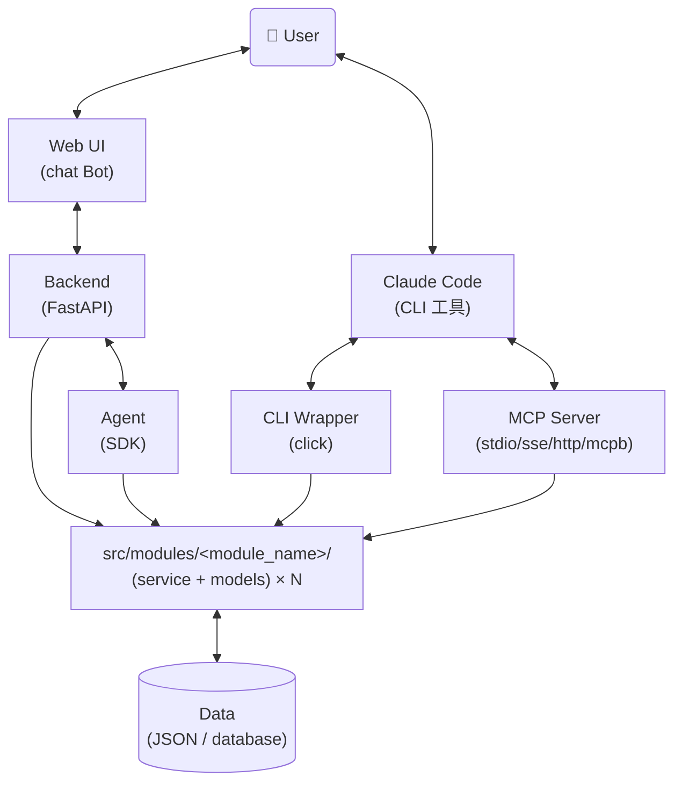

# Design Reference

> PM 设计阶段按需读取的参考手册。包含 doc/ 文件章节契约、schema 设计原则、跨文件归属表等规则。
> 进入 `designing` 状态时，PM 应读本文件后再撰写 doc/。

## 目录

- [1. 设计工作原则](#1-设计工作原则)
- [2. 模块定义](#2-模块定义)
- [3. Agent参考架构](#3-agent参考架构)
- [4. doc/<module_name>/ 章节契约](#4-docmodule_name-章节契约)
  - [4.1 README.md（模块门面）](#41-readmemd模块门面)
  - [4.2 schema.md（业务数据结构定义）](#42-schemamd业务数据结构定义)
    - [4.2.1 文件结构](#421-文件结构)
      - [4.2.1.1 应有章节](#4211-应有章节)
      - [4.2.1.2 模板](#4212-模板)
    - [4.2.2 设计原则](#422-设计原则)
      - [4.2.2.1 命名原则](#4221-命名原则)
      - [4.2.2.2 类型选型原则](#4222-类型选型原则)
      - [4.2.2.3 注释原则](#4223-注释原则)
      - [4.2.2.4 一致性原则](#4224-一致性原则)
  - [4.3 persistence.md（数据存储方案）](#43-persistencemd数据存储方案)
  - [4.4 service.md（Service 接口契约 + 流程）](#44-servicemdservice-接口契约--流程)
  - [4.5 cli.md（CLI 契约，仅暴露 CLI 的模块才有）](#45-climdcli-契约仅暴露-cli-的模块才有)
- [5. 跨文件内容归属表](#5-跨文件内容归属表)
- [6. 设计文档产出清单](#6-设计文档产出清单)
- [7. CLI Layer](#7-cli-layer)
  - [7.1 CLI 设计原则](#71-cli-设计原则)
  - [7.2 CLI 设计归属（分两阶段）](#72-cli-设计归属分两阶段)
- [8. Agent Layer](#8-agent-layer)
- [9. Backend Layer](#9-backend-layer)
- [10. 代码目录结构](#10-代码目录结构)
  - [10.1 目录结构](#101-目录结构)
  - [10.2 CLI 调用方式](#102-cli-调用方式)

## 1. 设计工作原则

- **图表优先**：流程、交互、依赖关系优先用 mermaid 表达（flowchart / sequence / state）。能用图说明的不写文字；文字仅作图的补充说明
- **聚焦核心**：文档核心是四类内容 —— 数据结构定义、CLI 定义、模块边界与依赖、接口交互。其余（背景、概述、理由）保持精简
- **可审计性**：每个设计决策都必须记录选择理由，使设计过程可追溯
- **可讨论性**：设计方案应先与用户讨论确认后再定稿，不擅自做重大架构决定

## 2. 模块定义

**模块是 agent 系统的功能单元，提供一个独立的功能或服务。** 一个模块由以下要件构成，缺一不可：

| # | 要件 | 路径 |
|---|------|------|
| 1 | 独立源码 | `src/modules/<module_name>/` |
| 2 | 独立 CLI（仅暴露 CLI 的模块才有） | `src/modules/<module_name>/cli.py`（单文件） |
| 3 | 独立文档 | `doc/<module_name>/` |
| 4 | 独立单元测试 | `test/unit/<module_name>/` |

`doc/<module_name>/` 下的文件：

| 文件 | 内容 |
|------|------|
| `README.md` | 模块门面：名词概念 + 功能与职责 |
| `schema.md` | 业务数据结构定义 |
| `persistence.md` | 数据存储方案 |
| `service.md` | Service 接口契约 + 关键流程 |
| `cli.md` | CLI 契约（仅暴露 CLI 的模块才有） |

**命名**：`<module_name>` 统一使用下划线（`module_name`），四处路径同名。

**判别**：`src/` 下 `modules/` 之内的是模块；`src/` 下其余目录（`backend` / `frontend` / `skill` / `mcp`）不是模块。

## 3. Agent参考架构



## 4. doc/<module_name>/ 章节契约

每个 doc/<module_name>/ 文件按以下章节组织。撰写前对照契约，撰写后自检章节是否合规。

### 4.1 README.md（模块门面）

> 模块入口：讲清这个模块是什么、负责什么。**不重复** `schema.md` / `service.md` 的正文内容。

**应有章节**：
- 模块标题 + 一句话模块功能与职责
- `## 名词概念` —— 本模块核心功能与职责涉及的概念名词，三列表格：
  - 列：中文名 | 英文名 | 定义
  - 定义为一句话
- `## 功能与职责`（本模块提供什么功能；负责什么、不负责什么）
- `## 依赖关系`：
  - 依赖的模块 —— 本模块使用它什么功能
  - 被依赖的模块 —— 本模块向它提供哪些功能

### 4.2 schema.md（业务数据结构定义）

#### 4.2.1 文件结构

##### 4.2.1.1 应有章节

- 文件标题
- `## 数据结构总览` —— mermaid classDiagram，展示模块内**全部**实体及关系：
  - 节点：每个 dataclass 与 enum（enum 标注 `<<enumeration>>`）
  - 边：**组合**（字段持有子对象）用 `-->`；**按值引用**（引用其它实体的标识）与引用 enum 用 `..>`
  - 字段类型：列表统一写作 `List~T~`
- N × `## <EntityName>` —— dataclass / enum 定义

##### 4.2.1.2 模板

````markdown
# <Module> Schema

## 数据结构总览

```mermaid
classDiagram
    class <EntityA> {
        +field_a: <EnumName>
        +field_b: List~<EntityB>~
    }
    class <EntityB> {
        +field_c: str
    }
    class <EnumName> {
        <<enumeration>>
        VALUE_A
        VALUE_B
    }
    <EntityA> --> <EntityB> : field_b
    <EntityA> ..> <EnumName> : field_a
```

## <EntityName>

@dataclass
class <EntityName>:
    """<业务说明>"""
    field_a: str
        # <字段描述>

## <EnumName>

```python
class <EnumName>(str, Enum):
    VALUE_A = "value_a"   # <成员说明>
    VALUE_B = "value_b"   # <成员说明>
```
````

#### 4.2.2 设计原则

##### 4.2.2.1 命名原则

**命名风格**

- 实体名：`PascalCase`
- 字段名：`snake_case`

**原则一：名称必须自解释**——单位、时间点、标识等语义要素编进名字本身，不靠注释或上下文补齐。如 `timeout_seconds` 而非 `timeout` 加注释 "(s)"；`created_at` 而非 `create_time`。

**原则二：名称承载业务语义**

##### 4.2.2.2 类型选型原则

设计每个字段时，按以下原则选类型。**违反任一 = 设计缺陷**，需重新设计。

| 原则 | 反例 | 正解 |
|------|------|------|
| **str 仅用于自由文本**——需被解析/比较/计算/含结构化语义时禁用 | `value: str  # "X 个" / "无限制"` | `value_type: <EnumName>`<br>`value_count: Optional[int]` |
| **时间戳 / 日期用 `str`（上条的例外）**——时间戳统一 ISO 8601（UTC，如 `2026-07-26T10:00:00Z`）；纯日期用 `YYYY-MM-DD` | `create_time: str  # YYYY-MM-DD HH:MM:SS` | `created_at: str  # ISO 8601, UTC` |
| **Optional 表"未提供"**——与零值区分（None ≠ 0 ≠ ""） | `count: int = 0  # 无数据时填 0` | `count: Optional[int] = None  # None = 未提供, 0 = 显式零` |
| **成组字段封装 dataclass**——N 字段一起出现一起消失 | `tag_k1: str`<br>`tag_k2: str`<br>`tag_k3: str` | `tags: list[TagItem]`（`TagItem` 含 key + value，可扩展） |

**字段自检**（写完每个字段前对照）：

| 字段类型 / 形态 | 自检 |
|---------------|------|
| `str` | 值是自由文本或时间戳吗？其余需解析/比较/计算的值 → 改类型 |
| `Optional[X]` | None 语义是"未提供"还是"零值"？后者用默认值 |
| 多个相关字段 | 总是一起出现？若是 → 封装 dataclass |

##### 4.2.2.3 注释原则

每个字段按三个维度写注释：

| 维度 | 必要性 | 装什么 |
|------|--------|--------|
| 描述 | 必需 | 字段是什么、做什么、从哪来、与其它字段是什么关系 |
| 约束 | 按需 | 字段的有值条件与取值范围 |
| 示例 | 按需 | 实际业务真实值 |

**注释格式**：

- dataclass 字段 → 下一行缩进注释
- enum 成员 → 行尾注释
- 每个维度**各占一行**，示例不内联在描述里

##### 4.2.2.4 一致性原则

- `schema.md` 是该 module 数据结构（dataclass / enum）的**唯一真值**，跨文档一致性以本文件为准
- 与 `README.md`「名词概念」表**不要求互相覆盖**；两边都出现的概念，名称必须一致（英文名 ↔ class 名）、定义不得矛盾，冲突时以本文件 docstring 为准

### 4.3 persistence.md（数据存储方案）

> 聚焦"怎么存"——介质、Schema、读写、生命周期。**引用 schema.md 的 dataclass，不重复定义字段语义**。

**应有章节**：
- `## 存储介质`
- `## Schema`（含 CREATE TABLE / 索引 / 字段映射）
- `## 读写机制`
- `## 数据生命周期`（初始化 / 清理 / 备份）
- `## 配置`（环境变量、路径参数）

**存储介质选型**：优先 json、yaml 等简单持久化；较复杂场景使用数据库。

### 4.4 service.md（Service 接口契约 + 流程）

> Service.py 的实现契约。仅描述"是什么/怎么调用/怎么走流程"，**不解释"为什么这么设计"**。

**应有章节**：
- `## Service 接口`（class + 方法签名 + docstring）
- `## 关键流程`（mermaid sequence，按 use case 组织）

### 4.5 cli.md（CLI 契约，仅暴露 CLI 的模块才有）

> 设计期产出，作为 developer 实现 `src/modules/<module_name>/cli.py` 的契约。`--help` 运行时输出应与本文档一致。

**应有章节**：
- 文件标题 + 一句话说明
- N × `## <command>` 章节，每个含：
  - 功能说明（脚本用途、内部实现原理）
  - 输入 schema（arguments / options / `--json-input` 示例）
  - 输出 schema（成功响应 + 失败响应 + 错误码）
  - 使用示例（典型调用）


## 5. 跨文件内容归属表

`{Root}/doc/` 下的所有文件是**最终正式文档**，仅承载"是什么"（定义、契约、方案），**不承载"为什么"**（决策、讨论、分析过程）。过程性内容不落库——决策与讨论在对话中与用户完成，结论由 commit message / PR 描述承载（git history 已记录）。

每写一段内容前，先对照下表判断归属。命中"应写到 commit message / PR 描述"或"删"的，**不要写到 doc/**。

| 内容类别 | 应写到 | 不应写到 |
|---------|--------|---------|
| 业务字段定义（dataclass） | schema.md | persistence.md |
| 字段语义/约束 | schema.md（字段注释） | persistence.md |
| 内存对象（不持久化）dataclass | schema.md | persistence.md |
| CREATE TABLE / DDL | persistence.md | schema.md |
| 索引定义 | persistence.md | schema.md |
| Column ↔ 字段映射（仅非一一对应时） | persistence.md | schema.md |
| 存储介质选型理由 | persistence.md（一句话）；深度分析见 commit message / PR 描述 | service.md |
| 读写机制 | persistence.md | schema.md |
| 数据生命周期 | persistence.md | service.md |
| 配置（环境变量/路径） | persistence.md | service.md |
| Service 方法签名 | service.md | - |
| Service 关键流程 | service.md | - |
| 模块依赖关系（依赖 / 被依赖） | README.md | - |
| CLI 命令清单（产品级） | cli.md（designing 阶段定） | service.md / schema.md |
| CLI 详细 JSON I/O schema | cli.md（仅暴露 CLI 的模块） | schema.md / service.md |
| CLI 错误码定义 | cli.md（仅暴露 CLI 的模块） | schema.md |
| CLI 使用示例 | cli.md（仅暴露 CLI 的模块） | schema.md |
| 设计决策 | commit message / PR 描述 | doc/ |
| 决策对比（方案 A/B/C） | commit message / PR 描述 | doc/ |
| 实测数据 / POC 命中率 | commit message / PR 描述 | doc/ |
| Issue 引用（QA-XXX） | commit message / PR 描述 | doc/ |
| 异常场景（接口契约） | service.md（方法 docstring） | - |
| 异常场景（issue 上下文） | commit message / PR 描述 | service.md |
| 变更记录 / "X 已删除" | 删（不应存在任何 doc/） | 任何 |

**撰写自检**（写完每个 doc 文件后，扫描以下关键词）：

| 关键词 | 处理 |
|--------|------|
| `feature #` / `issue #` / `(#NNN)` 编号 | 删（commit / PR 已关联） |
| `实测` | 删（commit message / PR 描述承载） |
| `决策` / `为什么` / `权衡` / `相比` / `vs` | 删（commit message / PR 描述承载） |
| `YAGNI` / `留给后续` / `待定` / 本期明确排除 | 删（范围决策不落库） |
| `变更记录` / `第一版` / `第二版` / `架构调整` | 删除（git history 已记录） |

**反例**（过程性内容混入 doc/，禁止）：

```markdown
## <EntityName>

@dataclass
class <EntityName>:
    ...

**设计决策**：<某设计选择的理由>。
理由：① ... ② ... ③ ...
```

设计决策不落库（对话中与用户完成），由 commit message / PR 描述承载，不留在 doc/。

## 6. 设计文档产出清单

设计完成后，产出以下文件到 `{Root}/doc/<module_name>/`：

| 产出 | 条件 |
|------|------|
| `README.md` | 所有模块 |
| `schema.md` | 所有模块 |
| `persistence.md` | 所有模块 |
| `service.md` | 所有模块 |
| `cli.md` | 仅暴露 CLI 的模块 |
| `python3 src/modules/<module_name>/cli.py --help` 运行时输出 | 仅暴露 CLI 的模块 |


## 7. CLI Layer

### 7.1 CLI 设计原则
- **`--help as doc`**：CLI 命令文档通过 `python3 {Root}/src/modules/<module_name>/cli.py --help` 运行时输出获得（运行期产出），包含：
    - **功能说明**：脚本用途、内部实现原理
    - **输入说明**：参数、选项、结构化输入格式
    - **输出说明**：成功/失败响应结构、错误码定义
    - **使用示例**：典型调用场景
- **设计期契约在 `doc/<module_name>/cli.md`**：暴露 CLI 的模块，设计期写 `cli.md`，含每个命令的 JSON I/O schema、错误码、使用示例，作为 developer 实现 `cli.py` 的契约。developer 实现完成后，`cli.md` 与 `--help` 输出应一致（QA 验收时机械比对）
- data-oriented：CLI 以数据为中心，提供 `data layer` 数据相关的操作，如查询、修改、新增、删除等，command 与入参设计保持精简，避免过度设计
- 结构化输入输出：除了常规 CLI 的 arguments/options，提供 json 格式输入全量入参，输出格式统一使用 json，方便代码或 agent 解析
- 使用 `click` 框架
- 使用 `dataclass` 定义 data schema
- 默认使用 `python3`

### 7.2 CLI 设计归属（分两阶段）

暴露 CLI 的模块，CLI 设计分布在两处：

| 阶段 | 文件 | 内容 |
|------|------|------|
| `designing`（设计） | `doc/<module_name>/cli.md` | 命令清单（产品级，要做哪些命令）+ 每命令的详细 JSON I/O schema、错误码、使用示例（设计期契约） |
| `implementing`（developer 实现） | `src/modules/<module_name>/cli.py` docstring + click decorators → 运行时 `--help` | 实现 `cli.py`，运行 `--help` 输出应与 `cli.md` 一致 |

产品级命令清单在讨论中与用户确定后直接写入 `cli.md`；developer 实现 `cli.py` 时按 `cli.md` 写 click decorators + docstring，`--help` 输出应与 `cli.md` 一致。

## 8. Agent Layer

- 使用 Claude SDK (Anthropic SDK) 或 Claude Agent SDK 构建 Agent
- **Agent 职责边界**：Agent 负责理解用户意图、编排任务流程、调用工具（执行实际业务逻辑的工具）
- **Agent 调用模块能力的两条路径**：
  - 经 CLI：执行 `python3 src/modules/<module_name>/cli.py <command>`（跨进程；模块未暴露 CLI 时不可用）
  - 直接 import：`from src.modules.<module_name>.service import ...`（同进程）
- Agent 通过 `src/modules/<module_name>/service.py` 完成数据操作
- 定义目标 Agent 的 system prompt，可通过 Claude Code 的 append-system-prompt 使用，也可通过 Anthropic SDK 或 Claude Agent SDK 使用，根据实际需求决定
- 实现时可参考 `/claude-api` skill

## 9. Backend Layer

- backend 技术选型
- REST API 设计，针对每一个 API，列出接口定义，包括接口功能、输入、输出，使用 mermaid 语法列出 API 的调用流程，与内部模块（如 agent、`src/modules/<module_name>/`、data layer）的交互流程
- **Backend 直接 import `src/modules/<module_name>/service.py`，不经过 CLI**

## 10. 代码目录结构

### 10.1 目录结构

```
{Root}/
  src/
    modules/
      <module_name>/
        __init__.py
        service.py          # 业务逻辑
        models.py           # dataclass + enum
        cli.py              # 仅暴露 CLI 的模块才有：python3 src/modules/<module_name>/cli.py --help
    backend/                # 非模块
    frontend/               # 非模块
    skill/                  # 非模块
    mcp/                    # 非模块
  doc/
    <module_name>/
      README.md
      schema.md
      persistence.md
      service.md
      cli.md                # 仅暴露 CLI 的模块才有
  test/
    unit/
      <module_name>/
```

### 10.2 CLI 调用方式

所有 CLI 调用使用脚本方式：`python3 src/modules/<module_name>/cli.py --help`。

`cli.py` 内部通过绝对路径 import `src` 业务逻辑：

```python
# src/modules/<module_name>/cli.py
from pathlib import Path
import sys

# parents[3] = {Root}。深度由「模块定义」固定的 CLI 路径决定；CLI 路径变更需同步改此处
sys.path.insert(0, str(Path(__file__).resolve().parents[3]))
from src.modules.<module_name>.service import <Module>Service
# ... click 命令定义
```
